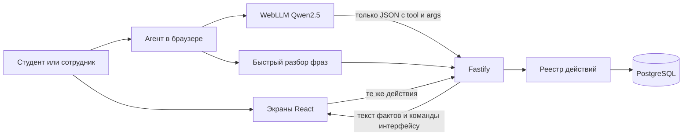

# Архитектура

Альтаир — личный кабинет, в котором агент не боковая справка, а основной способ действовать. Классические экраны остаются: расписание, оценки, заявки, уведомления, профиль, кабинет сотрудника.

## Потоки

Модель не читает базу и не подставляет идентификатор человека. Она возвращает JSON `{ say, steps: [{ tool, args }] }`. Сервер проверяет его zod-схемой, отбрасывает `userId` / `studentId`, выполняет шаг от имени сессии и сам пишет ответ по данным. Если JSON кривой, браузер просит модель исправить его один раз и при повторной ошибке уходит в быстрый режим.

## Реестр

`shared/src/registry.ts` — единственный список действий: имя, риск, роли, схема аргументов, короткая подсказка для промпта.

Риск:

- `read` — сразу. Чтение само открывает нужный экран.
- `reversible` — сразу, в журнале есть отмена: тема, прочитанные уведомления, напоминание, отметка занятия.
- `consequential` — заявление, отзыв, смена статуса сотрудником, объявление. Агент только готовит карточку. Запись происходит после `POST /api/agent/confirm`. Кнопка в форме — уже подтверждение, поэтому тот же обработчик вызывается с `source: "ui"`.

Добавить возможность = схема в реестре, функция в `server/src/actions.ts`, экран или кнопка. Промпт собирается из реестра и роль его фильтрует.

## Где считается ответ

`shared/src/navigator.ts` считает автомат по тем же порогам, что написаны в положении об аттестации: 4,75 и 4,20 для экзамена, 3,00 для зачёта, двойка закрывает автомат. `shared/src/parser.ts` разбирает фразы вроде «что завтра», «справка для военкомата», «сколько по матану для автомата», если модели нет. `shared/src/narrate.ts` собирает русский текст сводки.

## Модель

Основной путь — `@mlc-ai/web-llm` в воркере браузера:

- обычная: `Qwen2.5-1.5B-Instruct-q4f16_1-MLC`
- слабое устройство: `Qwen2.5-0.5B-Instruct-q4f16_1-MLC`
- по желанию: `Qwen2.5-3B-Instruct-q4f16_1-MLC`

Веса качаются один раз с Hugging Face и остаются в кэше. Контекст урезан до 2048 токенов у меньших моделей. Выдача ограничена JSON-схемой (`response_format.json_object` + schema). Пока модель не скачана или нет WebGPU, кабинет работает в быстром режиме. Индикатор в панели агента это показывает.

`LOCAL_LLM_URL` — необязательный OpenAI-совместимый endpoint (Ollama, llama.cpp) на отдельной машине. Сервер 1 ГБ его не запускает.

GigaChat и YandexGPT описаны в `server/src/llm.ts` и не вызываются, пока явно не включён `ENABLE_CLOUD_LLM`. Интерфейс этот режим не предлагает. В облако не отправляются результаты инструментов.

## Данные

Схема — `server/migrations/001_init.sql` и зеркало в Drizzle. Студент привязан к группе, расписание — к группе, оценки и заявки — к `student_id` из сессии. Сотрудник видит входящие заявления, но не получает инструмент оценок.

Уведомления доезжают потоком `GET /api/notifications/stream` и запасным опросом раз в 20 секунд.

## Интерфейс

На широком экране агент — постоянная колонка. Уже 1280 px она видна. На телефоне над нижней панелью постоянное поле «Спросите деканат…», разговор открывается поверх страниц и не сбрасывается при переходах: состояние лежит в `sessionStorage` этого пользователя. Команда интерфейсу — `navigate`, `highlight`, `theme`, `invalidate`. Подсветка ищет `[data-agent-target]`.

Стеклянный вид наследует палитру StellarSchool: мятный фон `#e6fff5`, акцент `#02BF7A`, в тёмной теме фон `hsl(228 40% 7%)` и индиго. Кнопки с текстом используют более тёмный зелёный `#046b45`, чтобы контраст был достаточным.
